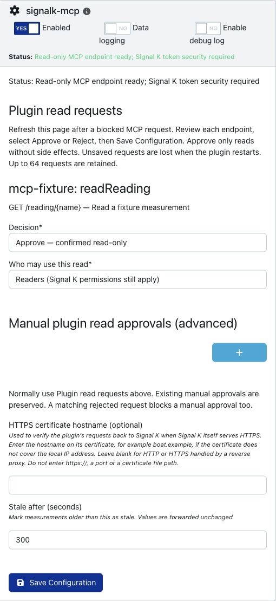

# Signal K MCP

A native, read-only Signal K plugin for vessel telemetry, capability discovery and approved plugin API calls over MCP Streamable HTTP. It runs at `/plugins/signalk-mcp/mcp`, using the existing Signal K server, bearer tokens and permissions. No extra account, key, listener or container is required.

**Scope:** discover, fetch and forward authorized data. The gateway does not calculate, aggregate, transform or infer data values and does not provide code execution. Provider-computed results may be fetched and forwarded without being recomputed.

**Development status:** authenticated telemetry and the read-only capability layer are implemented and integration-tested against Signal K 2.32.0 and 2.33.0. There is no npm/AppStore release or vessel deployment yet. See [compatibility verification](docs/verification.md) for the exact test fixtures and limits.

[Project brief](BRIEF.md) · [Working instructions](AGENTS.md) · [Architecture](docs/architecture.md) · [Capability design](docs/capabilities.md) · [Verification](docs/verification.md)

## Install for evaluation

Use Node.js 24 (Signal K's recommended major); Node 22 or later is required. From the repository:

```sh
npm ci --ignore-scripts --omit=optional
npm run check
npm pack
```

Install the tarball in a **test** Signal K 2.32.0 or 2.33.0 configuration directory, using its service account:

```sh
npm install --omit=dev --ignore-scripts /absolute/path/signalk-mcp-0.1.0.tgz
```

Restart Signal K, configure the plugin in Plugin Config, then enable it:

```json
{
  "allowedHosts": ["boat.example:3000"],
  "allowedOrigins": [],
  "staleAfterSeconds": 300,
  "pluginOperations": []
}
```

`allowedHosts` contains exact incoming Host headers, including ports. Behind a proxy, configure the Host it forwards. Forwarded host headers do not determine trust. An empty `allowedOrigins` rejects present Origin headers and permits native clients that omit Origin. Browser use also depends on Signal K's CORS policy.

Enable Signal K security and supply an existing user/device token in `Authorization: Bearer <token>` on every request. Guest reads and security-disabled servers are refused. The plugin does not create tokens or read signing secrets. Use Signal K TLS or a trusted TLS reverse proxy for remote access.

The native configuration form below was verified with Signal K 2.33.0 and synthetic fixtures. Its loopback address is an example, not a vessel setting.



See [package verification, upgrade/removal and release acceptance](docs/release-readiness.md) before preparing an installation candidate.

## Connect and discover

Configure a Streamable HTTP client with your endpoint, for example `https://boat.example/plugins/signalk-mcp/mcp`, and the bearer header. The nine tools keep discovery separate from execution:

| Tool                  | Purpose                                                             |
| --------------------- | ------------------------------------------------------------------- |
| `list_paths`          | Discover authorized self-context measurement paths, with pagination |
| `get_values`          | Read 1–64 paths with native units, timestamps, source and freshness |
| `get_vessel_state`    | Read a compact navigation and environment snapshot                  |
| `get_history`         | Fetch standard v2 History results using Signal K permissions        |
| `list_notifications`  | Fetch authorized v2 notification registry records, with pagination  |
| `get_notification`    | Fetch one authorized v2 registry record by its listed ID            |
| `list_capabilities`   | List core capabilities, installed plugins and advertised APIs       |
| `describe_capability` | Inspect operation inputs, permissions, support and approval state   |
| `execute_capability`  | Invoke a core or explicitly approved read-only plugin operation     |

For telemetry:

```json
{ "paths": ["navigation.position", "navigation.speedOverGround"] }
```

The same implementation is available through `execute_capability`:

```json
{
  "id": "signalk.telemetry",
  "operation": "get_values",
  "arguments": { "paths": ["navigation.speedOverGround"] }
}
```

Core capabilities are `signalk.telemetry`, `signalk.notifications` and `signalk.history`. `signalk.notifications` retains `list` for legacy `notifications.*` measurements and adds `list_notifications` and `get_notification` for the released server Notifications API. The two new operations are also dedicated MCP tools. This uses `/signalk/v2/api/notifications`, not the proposed `/signalk/v2/api/alerts` subsystem.

`list_notifications` accepts `offset` (default 0) and `limit` (default 32, maximum 64). It returns `{ "registry": "v2", "notifications": { "<id>": { "context": "...", "path": "...", "value": {} } }, "nextOffset": null }`. Records are sorted by ID and paginated after permission filtering; pages are not stable snapshots. Pass a listed key as `get_notification`'s `id`; it returns `{ "registry": "v2", "id": "...", "notification": { ... } }`. Non-UUID keys are supported when core management is disabled.

The gateway forwards permitted records unchanged, including status, timestamps and source metadata when supplied. It neither requires nor invents optional fields. The supported server releases omit source IDs from registry records. With ACLs configured, access therefore requires an exact value match in the native data model and a native read grant for every matching source at the record's context/path. Unmatched, ambiguous-denied, expired-model and unauthorized records are omitted. An admin token does not bypass ACLs. Missing and denied IDs both report `NOTIFICATION_UNAVAILABLE`. See [the permission boundary and upstream limitations](docs/capabilities.md#notifications-boundary).

Only the collection GET is used, including for single-record lookup. This also supports registry reads when core notification management is disabled. No acknowledge, silence, raise, clear or update operation is exposed.

Values retain native units. Zero and false remain valid; null is `missing`, while absent or denied paths are `unavailable`. Missing units/timestamps remain null. Invalid or future timestamps produce `unknown` freshness. The staleness threshold is included; it does not establish sensor health. Current telemetry exposes selected-source measurement leaves on `vessels.self`, excluding arbitrary parent objects, other vessels, static identity fields and server configuration. Pagination is not a stable snapshot.

## Approve a plugin operation

Plugins appear as `plugin.<plugin-id>`. Describe one to read its OpenAPI operations. Missing documents, disabled plugins, unsupported schemas and unapproved operations are reported explicitly. Other advertised APIs appear as `api.<name>` with `ADAPTER_REQUIRED`; discovery never enables control functions.

All plugin operations start disabled. After reviewing the target implementation for side effects, data authorization and safe inputs/outputs, add an exact allowlist entry. This illustrative entry assumes an installed plugin with that documented operation:

```json
{
  "pluginId": "example-weather",
  "operationId": "getForecast",
  "method": "GET",
  "path": "/forecast/{area}",
  "readOnly": true,
  "permission": "readonly"
}
```

Put entries in `pluginOperations`. Only GET is supported; `readOnly: true` is an explicit assertion by the administrator who reviewed the operation, not a fact inferred from HTTP or OpenAPI. Use `permission: "admin"` to add an admin-only requirement. Review approvals again when providers change.

Execution forwards the original bearer token to the same Signal K server. Native route checks and the provider's own authorization remain active; even an approved operation can return `UPSTREAM_PERMISSION_DENIED`. The provider must correctly enforce any data-level permissions its endpoint needs. Generic JSON cannot be mapped automatically onto Signal K telemetry ACLs. Approve only endpoints whose authorization and bounded read-only behavior have been reviewed.

OpenAPI support is deliberately partial: versions 3.0/3.1; published or route-derived operation IDs; primitive path/query parameters; bounded local component references; enums and basic numeric/string limits. Arrays, objects, patterns, composition, external references, request bodies and credential/network-target parameters are disabled. Path parameters accept letters, digits, underscores and hyphens. Header/cookie parameters and extra credentials are unsupported. Provider `servers` URLs and redirects are never followed.

## Historical data

`describe_capability({"id":"signalk.history"})` reports registered providers. Without a provider, queries return `HISTORY_UNAVAILABLE`.

Example `get_history` arguments, using the exact source ID from your own measurements:

```json
{
  "from": "2026-10-17T00:00:00Z",
  "to": "2026-10-18T00:00:00Z",
  "resolution": 300,
  "paths": [
    {
      "path": "navigation.speedOverGround",
      "source": "sensor.XX",
      "method": "average"
    }
  ]
}
```

Each explicit path/source filter is checked against the caller's Signal K ACLs before querying and after receiving the result. Response `$source` is optional in v2: if supplied it must match the requested filter. A source filter can be omitted only when native `anyACLs()` confirms that no telemetry ACLs are configured; otherwise the query returns `PERMISSION_DENIED`. An empty-source or wildcard ACL check cannot establish access to every historical source. This guards the standard History endpoint, which does not itself apply telemetry ACL checks in the tested servers.

Queries cover at most seven days and allow at most 16 columns and 2,000 returned rows. Use `from` + `to`, `from` + `duration`, `to` + `duration`, `duration` alone, or `from` alone (ending now). Boundaries are timezone-qualified timestamps; `duration` is an integer number of seconds. `resolution` is optional, in seconds; when supplied the request is also limited to 2,000 time buckets. Supported explicit methods are `average`, `min`, `max`, `first`, and `last`; omitting the method uses the standard server default. The gateway forwards the original query options and provider JSON, preserving context, range, column metadata, bucket timestamps, zero and null. It adds no units, source labels or derived values. When multiple authorized sources are requested for the same path/method, missing source labels stay missing; the gateway does not guess which source belongs to each column.

Signal K 2.32.0 and 2.33.0's HTTP parser strips hyphens from history path/source expressions. This implementation rejects those spellings rather than querying a changed identifier. The adapter uses the standard v2 API and has no database-specific runtime dependency. The unchanged `signalk-to-influxdb` 1.11.0 works in the tested cases with real InfluxDB 1.8.10 and synthetic data, including responses without `$source`. Other conforming providers use the same adapter, but have not all been individually tested. See [provider verification and remaining limits](docs/history-providers.md).

## Compatibility and limits

Validated transport: MCP TypeScript SDK 1.32.1, protocol through `2025-11-25`, plus Python MCP SDK 1.26.0. Installed Codex CLI/app-server and Hermes CLI/registry runtimes also pass isolated product-client tests; see the [dated client matrix and setup](docs/clients.md). Desktop/web UI acceptance remains untested. OAuth discovery is not implemented; [ADR 002](docs/decisions/002-client-authentication.md) records the native identity/delegation gap.

The MCP endpoint is stateless: GET/DELETE return 405, each POST has an independent server, and there is no event stream or session resumption. Limits: eight concurrent requests, 64 KiB parsed requests, 256 KiB results, 15-second HTTP request deadline, five seconds and 256 KiB per provider response, bounded discovery and model traversal. Signal K parses incoming JSON before plugin checks. Shared event-loop calls cannot be preempted by these deadlines; this is not process isolation.

Provider requests derive their destination from the accepted local server socket, never client input or proxy headers. TLS certificate verification remains enabled. Native HTTPS can use `localTlsServerName` to verify a DNS certificate while retaining that fixed destination; private CAs require process-level trust configuration. See [tested TLS/proxy topologies and setup](docs/hosting.md). Non-TCP hosting remains unsupported. Core telemetry remains independent of provider HTTP calls.

Authentication/read authorization uses version-sensitive Signal K internals isolated in `src/auth.ts`. Missing hooks fail closed; the supported release set is Signal K 2.32.0 and 2.33.0 on Node 22 and 24; see the [authentication compatibility record](docs/authentication.md). OAuth interoperability and publishing remain future work. Calculations, sandbox execution, Container Manager integration and writes/control are outside scope.

## Development

```sh
npm run check
```

Tests use a real temporary Signal K instance, a synthetic installed provider, disposable identities and synthetic deltas. Signal K binds its test listener using its default address; run in an isolated development environment. No vessel connection is configured.

`npm test` runs the portable permission, schema, history-validation and local HTTP transport tests without forced exit. `npm run test:integration` runs the native Signal K, hosting, provider and lifecycle tests. `npm run check` includes both suites plus type, lint and format checks.

The official [Signal K plugin CI](https://github.com/SignalK/signalk-server/blob/master/.github/workflows/plugin-ci.yml) runs the portable suite and upstream package/schema/lifecycle checks on Linux x64, Linux ARM64, macOS and Windows with Node 22/24. Our separate native integration CI retains the Signal K 2.32.0/2.33.0 matrix, Python MCP and real disposable InfluxDB. Generic upstream checks do not establish native permission compatibility, hardware acceptance or a registry score.

To include the second client (Python 3.10+):

```sh
python3 -m venv /tmp/signalk-mcp-python
/tmp/signalk-mcp-python/bin/pip install -r test/python-requirements.txt
MCP_TEST_PYTHON=/tmp/signalk-mcp-python/bin/python npm run test:integration
```

Without `MCP_TEST_PYTHON`, that test is explicitly skipped. Credentials reach Python over stdin. The native integration runner uses `--test-force-exit` after tests/cleanup because the upstream test server leaves background handles after stopping; the plugin does not force process exit.

The separate lifecycle test checks gateway-owned timer/TCP cleanup before terminating residual server processes and also runs without forced test exit. The opt-in local ARM64 benchmark passed the agreed development gates. Full server process replacement preserves client access and permissions in native tests; in-process server shutdown still has upstream cleanup gaps. Raspberry Pi acceptance remains open. Oversized ordinary JSON results now stop serialization at the byte budget, but that is not a total host-memory limit. See [resource results, reproduction commands and limits](docs/resource-validation.md).

To verify an installed tarball, set `MCP_TEST_PLUGIN_DIR` to the installed package directory while running the integration test. CI covers Signal K 2.32.0 and 2.33.0 on Node 22 and 24 with both clients. See the verification report for actual results and outstanding acceptance work.
