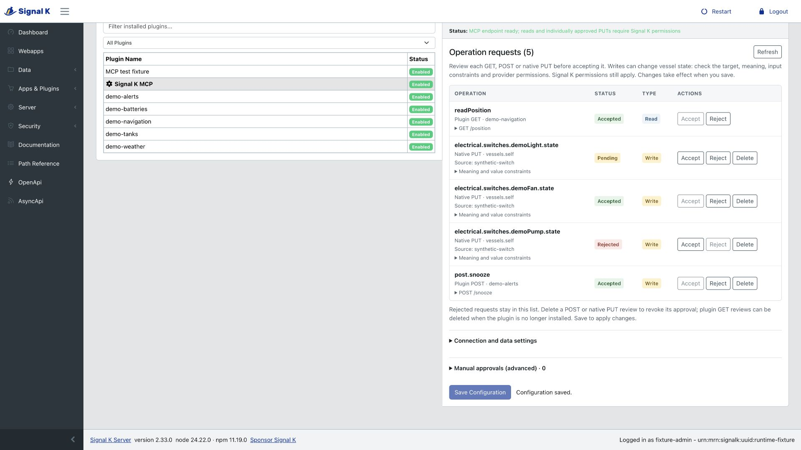

# Signal K MCP

Connect an AI agent to your boat’s Signal K data. Ask for current readings, available sensors, notifications or recorded history, and let the agent use MCP tools to fetch the information.

Signal K MCP runs as a plugin inside your existing Signal K server. It uses Signal K’s accounts and permissions, with no separate server or account to manage.

Supported versions are Signal K **2.32.0 and 2.33.0**, with Node.js **22 or 24**. Node.js **24** is recommended. See [compatibility and limits](#compatibility-and-limits) for the scope of testing.

## What you can do

- Read current vessel measurements, including their units, timestamps and sources.
- Discover available data and installed plugin capabilities.
- Read notifications and historical data from an installed History API provider.
- Use selected plugin operations and native control actions after an administrator approves each one.

The plugin fetches and forwards data. It does not calculate derived values or run agent-written code. Data availability depends on your sensors, installed providers and Signal K permissions.

## Install and enable

1. Use Node.js 24 for the recommended setup and enable [Signal K security](https://demo.signalk.org/documentation/Security.html#enabling-security). MCP connections always need a token, even if Signal K allows guest reads.
2. In your **Signal K configuration directory** (usually `~/.signalk`), run this command as the account that runs Signal K:

   ```sh
   npm install --omit=dev --ignore-scripts signalk-mcp@0.1.1
   ```

3. Restart Signal K and open **Apps & Plugins → Configuration → Signal K MCP**.
4. Click **Save Configuration** to save the defaults. After the page refreshes, use the **Enabled** switch to enable the plugin and save the change.

Your MCP endpoint is your Signal K server address followed by `/plugins/signalk-mcp/mcp`, for example:

```text
https://boat.example/plugins/signalk-mcp/mcp
```

Replace `https://boat.example` throughout this guide with your server’s address. The computer running your agent must be able to reach it. Use HTTPS for remote access; see the [HTTPS and reverse-proxy guide](docs/hosting.md) for setup and browser access settings.

## Create a Signal K token

Use Signal K’s standard token-generation utility for a dedicated user account:

1. In the Signal K Admin UI, open **Security → Users** and add a user such as `mcp-agent` with **Read Only** permissions.
2. Open a terminal on the Signal K server and run the following as the account that runs Signal K:

   ```sh
   signalk-generate-token -u mcp-agent -e 30d -s ~/.signalk/security.json
   ```

   Replace `mcp-agent` with the username you created. If your server uses a different configuration directory, replace `~/.signalk/security.json` with its actual path. This example creates a token valid for 30 days.

3. Copy the printed token into your agent’s secret settings or password manager. Treat it like a password: do not paste it into a chat, commit it to a repository or include it in screenshots.

The token uses that user’s current Signal K permissions. Start with **Read Only** for viewing data. For approved actions, the user needs **Read/Write** access as well as the individual operation approvals described below. Native PUT actions also require Signal K’s `put` permission for the exact target and source. An administrator token is not needed for ordinary data reads.

Generate a replacement when the token expires. Remove the dedicated user under **Security → Users** to revoke its access. See Signal K’s [token-generation guide](https://demo.signalk.org/documentation/Security/Generating_Tokens.html) for details. Existing Signal K user or device tokens also work; there is no separate MCP token to create.

## Connect your agent

Use an agent that supports **MCP Streamable HTTP** and a bearer token. In its MCP connection settings, enter:

| Setting              | Value                                          |
| -------------------- | ---------------------------------------------- |
| Server name          | `signalk`                                      |
| Transport            | Streamable HTTP                                |
| URL                  | `https://boat.example/plugins/signalk-mcp/mcp` |
| Authorization header | `Bearer YOUR-SIGNAL-K-TOKEN`                   |

Use the client’s secret storage or environment-variable support for the token. Signal K MCP does not provide an OAuth login flow. Clients that only offer OAuth cannot connect directly through that flow.

Choose your client’s instructions; the configuration keys and token syntax differ:

| Client                        | Setup guide                                                                            |
| ----------------------------- | -------------------------------------------------------------------------------------- |
| Codex                         | [CLI and desktop configuration](docs/clients.md#codex)                                 |
| Claude Code                   | [HTTP server configuration](docs/clients.md#claude-code)                               |
| Claude Desktop / web / Cowork | [Custom connector with a bearer header](docs/clients.md#claude-desktop-web-and-cowork) |
| Cursor                        | [MCP configuration](docs/clients.md#cursor)                                            |
| VS Code / GitHub Copilot      | [Setup with a hidden token prompt](docs/clients.md#vs-code--github-copilot)            |
| GitHub Copilot CLI            | [Interactive setup](docs/clients.md#github-copilot-cli)                                |
| Gemini CLI                    | [Streamable HTTP configuration](docs/clients.md#gemini-cli)                            |
| Hermes                        | [Profile configuration](docs/clients.md#hermes)                                        |
| OpenCode                      | [Remote server configuration](docs/clients.md#opencode)                                |
| Windsurf / Cascade            | [Cascade configuration](docs/clients.md#windsurf--cascade)                             |
| ChatGPT                       | [Desktop and hosted connection limits](docs/clients.md#chatgpt)                        |

These recipes follow official client documentation. The [verification status](docs/clients.md#verification-status) distinguishes tested runtimes from documentation-only guidance. Cloud-hosted connectors must be able to reach your server from their own network; access from your laptop alone is not sufficient.

### Try it in a chat

Once connected, ask your agent:

> Use Signal K to show my current position, speed over ground and wind readings. Include units and timestamps, and flag missing or stale data.

> List the measurements I can access, then show the available battery readings.

> Show the notifications I’m allowed to read, including their reported status.

> Check whether a history provider is available. If it is, fetch the last hour of speed-over-ground history.

The agent discovers and calls the tools; you do not need to write JSON requests. A useful instruction for your agent is:

> Discover available paths and capabilities before using them. Preserve units, timestamps and missing values. Ask me before any action that changes state. If an action has an unknown outcome, do not retry it automatically.

## Approve plugin operations and actions

Built-in telemetry, history and notification reads use your Signal K permissions immediately. **Every plugin read, plugin POST and native PUT action needs its own saved administrator approval.** There is no allow-all setting, and an agent cannot approve itself.

When an agent attempts an eligible operation that has not been approved, it receives `APPROVAL_PENDING`. The operation has not run.

1. Open **Apps & Plugins → Configuration → Signal K MCP** and click **Refresh**.
2. In **Operation requests**, review the requested operation and its **Read** or **Write** label. Expand the details to check what it does, its inputs and, for native controls, the exact path and source. Review the provider’s behavior and permissions before accepting.
3. Click **Accept** or **Reject**, then **Save Configuration**. Decisions take effect only after saving.
4. After approval, ask the agent to try the operation again.



_The screenshot uses synthetic example requests, not live vessel data._

Saved approvals survive restarts and allow later calls while Signal K permissions still apply. The plugin does not ask for confirmation on every call; configure your agent to ask before changing state. Changed operation contracts require a new review. Unsaved requests disappear on restart, so refresh the table before reviewing and saving.

If a submitted action times out or loses its connection, its outcome may be unknown. Do not retry automatically. A successful response alone does not prove that physical equipment acted.

## Upgrading

Back up your Signal K configuration and record the installed plugin version. Disable the plugin, install `signalk-mcp@0.1.1` with the command above, and restart the Signal K server process. Review the saved operation approvals and native permissions before re-enabling it. See the [upgrade and rollback procedure](docs/release-readiness.md#upgrade-rollback-and-removal).

Version 0.1.0 includes the earlier alpha features plus mixed-case plugin discovery, clearer native PUT diagnostics and support for explicitly declared input choices. Existing approvals still require the same reviewed operation contract; the version change does not grant any new permissions.

## Compatibility and limits

- Native server and installed-package tests cover Signal K **2.32.0/2.33.0** on Node.js **22/24**, including TypeScript and Python MCP clients. Other server versions need separate verification.
- Product-client coverage varies. Earlier Codex and Hermes runtime checks covered reads; the current full tool catalog, desktop/web interfaces and ChatGPT tunnel connection are not all verified. Check the [client evidence](docs/clients.md#verification-status) before choosing a setup.
- History requires a compatible provider and is subject to the [documented path and source restrictions](docs/history-providers.md). Plugin operations require supported API descriptions and individual review.
- Restart the full Signal K process when upgrading. In-process whole-server shutdown has a documented upstream cleanup limitation.
- Local ARM64 tests do not establish Raspberry Pi compatibility or physical equipment operation. Complete vessel acceptance and public registry scoring are separate from automated test results.

## Troubleshooting

| What you see                         | What to check                                                                                                                                      |
| ------------------------------------ | -------------------------------------------------------------------------------------------------------------------------------------------------- |
| Connection or authentication failure | Confirm the plugin is enabled, the URL is reachable and the agent is sending a valid token. A browser login alone does not authenticate the agent. |
| Missing measurements                 | Ask the agent to list available paths. Check that Signal K receives the data and that the token’s user or device has permission to read it.        |
| `APPROVAL_PENDING`                   | Review and save the individual operation in Plugin Config, then try again.                                                                         |
| `HISTORY_UNAVAILABLE`                | Install and configure a provider for Signal K’s standard v2 History API.                                                                           |
| Permission denied after approval     | Check the token’s Signal K permissions and the provider’s own access requirements. Approval does not override either.                              |
| Certificate or browser-origin errors | Follow the [hosting guide](docs/hosting.md). Browser access follows Signal K’s server-wide CORS settings.                                          |

Upgrading from plugin-local `allowedHosts` or `allowedOrigins` settings? Those fields are now ignored; move any browser-origin restrictions to Signal K’s CORS settings. See [upgrade guidance](docs/hosting.md#browser-policy-and-upgrades).

## Further documentation

- [Agent connection examples and compatibility](docs/clients.md)
- [Tool reference, approval rules and limits](docs/reference.md)
- [Native control actions](docs/native-puts.md) and [plugin POST operations](docs/plugin-posts.md)
- [Installation upgrades, rollback and removal](docs/release-readiness.md#upgrade-rollback-and-removal)
- [Changelog](CHANGELOG.md)
- [Developer guide](docs/development.md) and [verification details](docs/verification.md)
