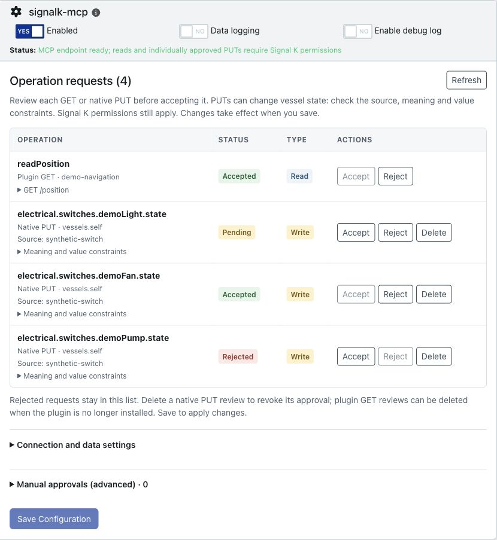

# Signal K MCP

A native Signal K plugin for vessel telemetry, capability discovery, approved plugin reads and individually approved native PUT actions over MCP Streamable HTTP. It runs at `/plugins/signalk-mcp/mcp`, using the existing Signal K server, bearer tokens and permissions. No extra account, key, listener or container is required.

**Individual approval required:** every plugin GET operation and every native PUT target starts blocked and needs its own explicit administrator approval saved in Signal K Plugin Config. There is no allow-all switch. Installing the gateway, discovering an operation or holding a write-capable token does not approve it. Approvals cover an exact operation/target, not every future operation from a plugin; Signal K permissions still apply on every call. Built-in telemetry, history and notification reads use native Signal K permissions without an extra operation review.

**Scope:** discover, fetch and forward authorized data and individually approved native actions. The gateway does not calculate, aggregate, transform or infer data values and does not provide code execution. Provider-computed results may be fetched and forwarded without being recomputed.

**Development status:** authenticated reads and individually approved native PUTs are implemented and integration-tested against Signal K 2.32.0 and 2.33.0 on Node 22/24. This is experimental software for evaluation; vessel acceptance, public registry indexing/score and end-to-end ChatGPT tunnel verification remain outstanding. See [compatibility verification](docs/verification.md) for the exact test fixtures and limits.

**Release status:** `0.1.0-alpha.2` adds individually approved native PUTs and fixes first-time configuration saving. Plugin POSTs remain disabled.

[Project brief](BRIEF.md) · [Working instructions](AGENTS.md) · [Architecture](docs/architecture.md) · [Capability design](docs/capabilities.md) · [Verification](docs/verification.md)

## What it provides

- Current vessel telemetry and capability discovery using native Signal K permissions.
- Notification reads and standard v2 History API results from installed providers.
- Reviewed plugin GET operations, with Accept/Reject controls and retained decisions in Plugin Config.
- Native self-context PUT actions, each bound to an individually saved path/source/metadata approval and native PUT permissions. There is no blanket PUT approval.
- MCP Streamable HTTP through the existing Signal K server; no separate plugin account or data store.



The screenshot uses synthetic example plugins and approval requests. It does not show live vessel data. Clients need a native Signal K bearer token and a reachable, trusted endpoint. ChatGPT tunnel setup is not yet verified end-to-end; no built-in OAuth login is provided.

## Install for evaluation

Use Node.js 24 (Signal K's recommended major); Node 22 or later is required. Install the alpha in a test Signal K configuration directory, using its service account:

```sh
npm install --omit=dev --ignore-scripts signalk-mcp@0.1.0-alpha.2
```

`signalk-mcp@next` selects the current prerelease. Alpha 2 updates `next` and leaves `latest` unchanged. To build from source:

```sh
npm ci --ignore-scripts --omit=optional
npm run check
npm pack
```

Install the tarball in a **test** Signal K 2.32.0 or 2.33.0 configuration directory, using its service account:

```sh
npm install --omit=dev --ignore-scripts /absolute/path/signalk-mcp-0.1.0-alpha.2.tgz
```

Restart Signal K, open the plugin in Plugin Config and click **Save Configuration**. You can save the defaults without editing anything. After the first save, the page refreshes to show Signal K’s **Enabled** switch; use it to enable the plugin:

```json
{
  "staleAfterSeconds": 300,
  "pluginOperations": []
}
```

The plugin needs no separate host or browser-origin lists. Browser requests follow Signal K’s server-wide CORS policy; configure browser access in Signal K’s security settings. A wildcard policy permits any valid HTTP(S) origin, while an explicit list restricts it. Every MCP request still requires its own valid bearer token; cookies alone do not grant access. Incoming Host and proxy headers never select an outbound destination.

Older `allowedHosts` and `allowedOrigins` plugin settings are ignored for upgrade compatibility. Move any browser-origin restrictions you need to Signal K’s server-wide CORS configuration before upgrading; the old plugin list no longer restricts access.

Enable Signal K security and supply an existing user/device token in `Authorization: Bearer <token>` on every request. Guest reads and security-disabled servers are refused. The plugin does not create tokens or read signing secrets. Use Signal K TLS or a trusted TLS reverse proxy for remote access.

The native configuration form pictured above was verified with Signal K 2.33.0 and synthetic fixtures. It shows one plugin GET and three native PUT review examples; no hardware is connected. The layout was checked at 390-, 1280- and 1920-pixel widths.

The release pipeline stamps the release commit into the package and verifies npm’s published `gitHead`. Alpha versions use the `next` distribution tag. See [registry score evidence](docs/registry-readiness.md) and [package verification, upgrade/removal and release acceptance](docs/release-readiness.md) before preparing an installation candidate.

## Connect and discover

Configure a Streamable HTTP client with your endpoint, for example `https://boat.example/plugins/signalk-mcp/mcp`, and the bearer header. The fourteen tools keep discovery separate from execution:

| Tool                  | Purpose                                                              |
| --------------------- | -------------------------------------------------------------------- |
| `list_paths`          | Discover authorized self-context measurement paths, with pagination  |
| `get_values`          | Read 1–64 paths with native units, timestamps, source and freshness  |
| `get_vessel_state`    | Read a compact navigation and environment snapshot                   |
| `get_history`         | Fetch standard v2 History results using Signal K permissions         |
| `list_notifications`  | Fetch authorized v2 notification registry records, with pagination   |
| `get_notification`    | Fetch one authorized v2 registry record by its listed ID             |
| `list_capabilities`   | List core capabilities, installed plugins and advertised APIs        |
| `describe_capability` | Inspect operation inputs, permissions, support and approval state    |
| `execute_capability`  | Invoke a core read or an individually approved plugin GET            |
| `list_put_paths`      | Discover metadata-advertised PUT candidates for an explicit source   |
| `describe_put`        | Read one PUT target's metadata and supplied value constraints        |
| `put_value`           | Submit one individually approved native action                       |
| `get_put_status`      | Check a gateway-submitted action owned by the same Signal K identity |
| `execute_mutation`    | Invoke the same native action through `signalk.put` / `put_value`    |

For telemetry:

```json
{ "paths": ["navigation.position", "navigation.speedOverGround"] }
```

The same implementation is available through `execute_capability`:

```json
{
  "id": "signalk.telemetry",
  "operation": "get_values",
  "arguments": { "paths": ["navigation.speedOverGround"] }
}
```

Core capabilities are `signalk.telemetry`, `signalk.notifications`, `signalk.history` and `signalk.put`. `signalk.notifications` retains `list` for legacy `notifications.*` measurements and adds `list_notifications` and `get_notification` for the released server Notifications API. The two notification operations are also dedicated MCP tools. This uses `/signalk/v2/api/notifications`, not the proposed `/signalk/v2/api/alerts` subsystem.

`list_notifications` accepts `offset` (default 0) and `limit` (default 32, maximum 64). It returns `{ "registry": "v2", "notifications": { "<id>": { "context": "...", "path": "...", "value": {} } }, "nextOffset": null }`. Records are sorted by ID and paginated after permission filtering; pages are not stable snapshots. Pass a listed key as `get_notification`'s `id`; it returns `{ "registry": "v2", "id": "...", "notification": { ... } }`. Non-UUID keys are supported when core management is disabled.

The gateway forwards permitted records unchanged, including status, timestamps and source metadata when supplied. It neither requires nor invents optional fields. The supported server releases omit source IDs from registry records. With ACLs configured, access therefore requires an exact value match in the native data model and a native read grant for every matching source at the record's context/path. Unmatched, ambiguous-denied, expired-model and unauthorized records are omitted. An admin token does not bypass ACLs. Missing and denied IDs both report `NOTIFICATION_UNAVAILABLE`. See [the permission boundary and upstream limitations](docs/capabilities.md#notifications-boundary).

Only the collection GET is used, including for single-record lookup. This also supports registry reads when core notification management is disabled. No acknowledge, silence, raise, clear or update operation is exposed.

Values retain native units. Zero and false remain valid; null is `missing`, while absent or denied paths are `unavailable`. Missing units/timestamps remain null. Invalid or future timestamps produce `unknown` freshness. The staleness threshold is included; it does not establish sensor health. Current telemetry exposes selected-source measurement leaves on `vessels.self`, excluding arbitrary parent objects, other vessels, static identity fields and server configuration. Pagination is not a stable snapshot.

## Approve a plugin operation

Plugins appear as `plugin.<plugin-id>`. Describe one to read its OpenAPI operations. Missing documents, disabled plugins, unsupported schemas and unapproved operations are reported explicitly. Other advertised APIs appear as `api.<name>` with `ADAPTER_REQUIRED`; discovery never enables control functions.

All plugin operations start disabled. When a client attempts a discovered, supported GET with valid arguments, the read stays blocked with `APPROVAL_PENDING`. The plugin prepares a deduplicated review entry without calling that endpoint or saving configuration.

1. Open **Apps & Plugins → Configuration → Signal K MCP** and click **Refresh**.
2. In the **Operation requests** table, review the plugin, operation and endpoint. Expand the endpoint to read its description. Provider descriptions are untrusted information; check the handler's side effects and data authorization. Native PUT rows additionally identify the exact path/source and show its metadata/value contract.
3. Check the **Read** or **Write** command type, click **Accept** or **Reject**, then **Save Configuration**. Buttons change the draft; nothing is persisted until you save. **Discard changes** restores the last loaded state. Signal K's native permissions determine who can execute an approved operation.
4. Ask the client to retry after approval. Approval never bypasses Signal K or provider permissions.

Unsaved requests live in memory and disappear on plugin/server restart, including a settings save from a stale page. Refresh before reviewing. Saved decisions survive restarts; rejected requests stay visible and blocked without creating duplicates. To change a rejection later, click **Accept** and **Save Configuration**. The queue holds at most 64 entries, including saved reviews; when full, new requests return `APPROVAL_QUEUE_FULL`. Rows for uninstalled plugins show **Not installed** and a **Delete** button. Click **Delete**, confirm **Delete row**, then **Save Configuration**. Disabled plugins still count as installed and cannot be deleted from this table. Other obsolete entries can be removed from `readRequests` in saved plugin configuration while the plugin is disabled. Removing a decision revokes that review's approval and allows a later request to be reviewed again. No arguments, tokens or data values are retained.

Plugin GET reviews bind the exact plugin, operation, GET path, supported input schema and description. Changed metadata requires another review; unchanged metadata cannot prove an unchanged implementation, so review provider upgrades too. A matching rejected review also overrides a manual approval. Plugin mutation methods, ambiguous operations and unsupported schemas never enter the plugin-read queue. Native PUTs use the same table with their own exact target binding; a GET approval never grants PUT access. There is no MCP approval/configuration-write tool.

Existing manual approvals remain supported under the expandable **Manual approvals (advanced)** section. This illustrative entry assumes an installed plugin with that documented operation:

```json
{
  "pluginId": "example-weather",
  "operationId": "getForecast",
  "method": "GET",
  "path": "/forecast/{area}",
  "readOnly": true,
  "permission": "readonly"
}
```

Put entries in `pluginOperations`. Only GET is supported; `readOnly: true` is an explicit assertion by the administrator who reviewed the operation, not a fact inferred from HTTP or OpenAPI. Use `permission: "admin"` to add an admin-only requirement. Review approvals again when providers change.

### How table and manual approvals interact

The table and manual approvals are separate lists; manual entries do not automatically create table rows. The following rules apply to saved entries matching the current supported operation:

| Table decision                | Matching manual approval | Result                                                                                                    |
| ----------------------------- | ------------------------ | --------------------------------------------------------------------------------------------------------- |
| Rejected                      | Present or absent        | Blocked; the table rejection wins.                                                                        |
| Accepted                      | Absent                   | Allowed under the table's access requirement.                                                             |
| Accepted                      | Present                  | Allowed under the stricter access requirement; if either requires administrators, the read is admin-only. |
| Pending                       | Present                  | The manual approval applies; pending does not override it.                                                |
| No matching review            | Present                  | The manual approval applies.                                                                              |
| Pending or no matching review | Absent                   | Unapproved; a valid attempt remains blocked and queues a request if needed.                               |

Removing a manual approval leaves the table decision unchanged: a rejection still blocks, and an acceptance still applies. Deleting a table row leaves any manual approval unchanged, so that manual approval may still allow the read when the plugin is available again. Save Configuration applies either change. Signal K and provider permissions, enabled-plugin checks and schema validation remain mandatory in every case.

The table uses Signal K’s embedded configurator, plugin inventory and existing admin configuration API. It preserves unrelated settings and newly queued requests, and checks for conflicting edits before saving. Signal K’s configuration API has no atomic compare-and-swap, so avoid simultaneous settings saves. Connection and staleness options remain available under **Connection and data settings**.

## Individually approved native PUTs

Use `list_put_paths` with an explicit handler `source`, then `describe_put` with that source and a path. The gateway forwards native metadata, including `supportsPut`, names, units and supplied enums/constraints. It can discover metadata-only paths observed after startup or previously described explicitly; earlier metadata-only targets may require a known-path `describe_put` first. The native API does not expose a complete handler-source catalog: use the actual provider's source identifier, and do not assume it equals the selected telemetry source. Listed paths are metadata candidates; the native handler decides whether a supplied source is registered.

`put_value` takes `{ "path": "...", "source": "...", "value": ... }`. Each eligible unapproved target remains blocked with `APPROVAL_PENDING`, without invoking a handler. Refresh **Operation requests**, review that exact **Write** row, click **Accept** or **Reject**, and **Save Configuration**. Every approved action still requires a native write-capable identity and exact-source `put` permission. Telemetry `write` permission is different. The table has no role selector: read-only identities cannot write. There is no all-PUT switch, wildcard target, inferred source, or MCP self-approval.

Native PUT approvals share the bounded 64-entry review queue with plugin GETs, survive native configuration saves, and bind context, path, source and reviewed metadata/value contract. Changed metadata or source requires fresh review. **Delete** a PUT review and confirm the removal to revoke it when saving; unlike plugin GET rows, native target revocation does not depend on a plugin being uninstalled. Existing GET approvals and decisions remain compatible.

`execute_mutation` with `{ "id": "signalk.put", "operation": "put_value", "arguments": { ... } }` uses the same implementation. `execute_capability` handles reads and refuses mutation execution. All other mutations, including plugin POSTs, remain disabled.

Native replies preserve request IDs, state and status codes. Check a known `requestId` through `get_put_status`; only actions submitted through this gateway by the same Signal K identity are accessible, with current permissions/approval rechecked. Correlations expire after one hour and clear on plugin restart. A completed response may still contain a failure status code. A timeout, disconnect or invalid response after dispatch can leave the outcome **unknown**: never automatically retry it or assume cancellation stopped the action. Successful completion does not establish physical operation. See [native PUT contracts and limits](docs/native-puts.md).

Execution forwards the original bearer token to the same Signal K server. Native route checks and the provider's own authorization remain active; even an approved operation can return `UPSTREAM_PERMISSION_DENIED`. The provider must correctly enforce any data-level permissions its endpoint needs. Generic JSON cannot be mapped automatically onto Signal K telemetry ACLs. Approve only endpoints whose authorization and bounded read-only behavior have been reviewed.

OpenAPI support is deliberately partial: versions 3.0/3.1; published or route-derived operation IDs; primitive path/query parameters; bounded local component references; enums and basic numeric/string limits. Arrays, objects, patterns, composition, external references, request bodies and credential/network-target parameters are disabled. Path parameters accept letters, digits, underscores and hyphens. Header/cookie parameters and extra credentials are unsupported. Provider `servers` URLs and redirects are never followed.

## Historical data

`describe_capability({"id":"signalk.history"})` reports registered providers. Without a provider, queries return `HISTORY_UNAVAILABLE`.

Example `get_history` arguments, using the exact source ID from your own measurements:

```json
{
  "from": "2026-10-17T00:00:00Z",
  "to": "2026-10-18T00:00:00Z",
  "resolution": 300,
  "paths": [
    {
      "path": "navigation.speedOverGround",
      "source": "sensor.XX",
      "method": "average"
    }
  ]
}
```

Each explicit path/source filter is checked against the caller's Signal K ACLs before querying and after receiving the result. Response `$source` is optional in v2: if supplied it must match the requested filter. A source filter can be omitted only when native `anyACLs()` confirms that no telemetry ACLs are configured; otherwise the query returns `PERMISSION_DENIED`. An empty-source or wildcard ACL check cannot establish access to every historical source. This guards the standard History endpoint, which does not itself apply telemetry ACL checks in the tested servers.

Queries cover at most seven days and allow at most 16 columns and 2,000 returned rows. Use `from` + `to`, `from` + `duration`, `to` + `duration`, `duration` alone, or `from` alone (ending now). Boundaries are timezone-qualified timestamps; `duration` is an integer number of seconds. `resolution` is optional, in seconds; when supplied the request is also limited to 2,000 time buckets. Supported explicit methods are `average`, `min`, `max`, `first`, and `last`; omitting the method uses the standard server default. The gateway forwards the original query options and provider JSON, preserving context, range, column metadata, bucket timestamps, zero and null. It adds no units, source labels or derived values. When multiple authorized sources are requested for the same path/method, missing source labels stay missing; the gateway does not guess which source belongs to each column.

Signal K 2.32.0 and 2.33.0's HTTP parser strips hyphens from history path/source expressions. This implementation rejects those spellings rather than querying a changed identifier. The adapter uses the standard v2 API and has no database-specific runtime dependency. The unchanged `signalk-to-influxdb` 1.11.0 works in the tested cases with real InfluxDB 1.8.10 and synthetic data, including responses without `$source`. Other conforming providers use the same adapter, but have not all been individually tested. See [provider verification and remaining limits](docs/history-providers.md).

## Compatibility and limits

Validated transport: MCP TypeScript SDK 1.32.1, protocol through `2025-11-25`, plus Python MCP SDK 1.26.0. Installed Codex CLI/app-server and Hermes CLI/registry runtimes also pass isolated product-client tests; see the [dated client matrix and setup](docs/clients.md). Desktop/web UI acceptance remains untested. OAuth discovery is not implemented; [ADR 002](docs/decisions/002-client-authentication.md) records the native identity/delegation gap.

The MCP endpoint is stateless: GET/DELETE return 405, each POST has an independent server, and there is no event stream or session resumption. Limits: eight concurrent requests, 64 KiB parsed requests, 256 KiB results, 15-second HTTP request deadline, five seconds and 256 KiB per provider response, bounded discovery and model traversal. Signal K parses incoming JSON before plugin checks. Shared event-loop calls cannot be preempted by these deadlines; this is not process isolation.

Provider requests derive their destination from the accepted local server socket, never client input or proxy headers. TLS certificate verification remains enabled. Native HTTPS can use `localTlsServerName` to verify a DNS certificate while retaining that fixed destination; private CAs require process-level trust configuration. See [tested TLS/proxy topologies and setup](docs/hosting.md). Non-TCP hosting remains unsupported. Core telemetry remains independent of provider HTTP calls.

Authentication/read/PUT authorization uses version-sensitive Signal K internals isolated in `src/auth.ts`. Missing hooks fail closed; the supported release set is Signal K 2.32.0 and 2.33.0 on Node 22 and 24; see the [authentication compatibility record](docs/authentication.md). OAuth interoperability remains future work. Calculations, sandbox execution, Container Manager integration, arbitrary configuration writes and unreviewed controls are outside scope. Plugin POSTs are a separate follow-up.

## Development

```sh
npm run check
```

Tests use a real temporary Signal K instance, a synthetic installed provider, disposable identities and synthetic deltas. Signal K binds its test listener using its default address; run in an isolated development environment. No vessel connection is configured.

`npm test` runs the portable permission, schema, history-validation and local HTTP transport tests without forced exit. `npm run test:integration` runs the native Signal K, hosting, provider and lifecycle tests. `npm run check` includes both suites plus type, lint and format checks.

The official [Signal K plugin CI](https://github.com/SignalK/signalk-server/blob/master/.github/workflows/plugin-ci.yml) runs the portable suite and upstream package/schema/lifecycle checks on Linux x64, Linux ARM64, macOS and Windows with Node 22/24. Our separate native integration CI retains the Signal K 2.32.0/2.33.0 matrix, Python MCP and real disposable InfluxDB. Generic upstream checks do not establish native permission compatibility, hardware acceptance or a registry score.

Both workflows run on pull requests, pushes to `main` and manual dispatch, avoiding duplicate feature-branch push runs. The official workflow owns portable tests and formatting; one local-workflow job enforces type checking and lint because upstream lint is advisory. The native matrix runs integration tests against the checkout and again against the installed tarball to verify packaging. `npm run check` remains the complete local check.

To include the second client (Python 3.10+):

```sh
python3 -m venv /tmp/signalk-mcp-python
/tmp/signalk-mcp-python/bin/pip install -r test/python-requirements.txt
MCP_TEST_PYTHON=/tmp/signalk-mcp-python/bin/python npm run test:integration
```

Without `MCP_TEST_PYTHON`, that test is explicitly skipped. Credentials reach Python over stdin. The native integration runner uses `--test-force-exit` after tests/cleanup because the upstream test server leaves background handles after stopping; the plugin does not force process exit.

The separate lifecycle test checks gateway-owned timer/TCP cleanup before terminating residual server processes and also runs without forced test exit. The opt-in local ARM64 benchmark passed the agreed development gates. Full server process replacement preserves client access and permissions in native tests; in-process server shutdown still has upstream cleanup gaps. Raspberry Pi testing is outside the release acceptance scope; the local ARM64 results do not establish Pi compatibility. Oversized ordinary JSON results now stop serialization at the byte budget, but that is not a total host-memory limit. See [resource results, reproduction commands and limits](docs/resource-validation.md).

To verify an installed tarball, set `MCP_TEST_PLUGIN_DIR` to the installed package directory while running the integration test. CI covers Signal K 2.32.0 and 2.33.0 on Node 22 and 24 with both clients. See the verification report for actual results and outstanding acceptance work.
