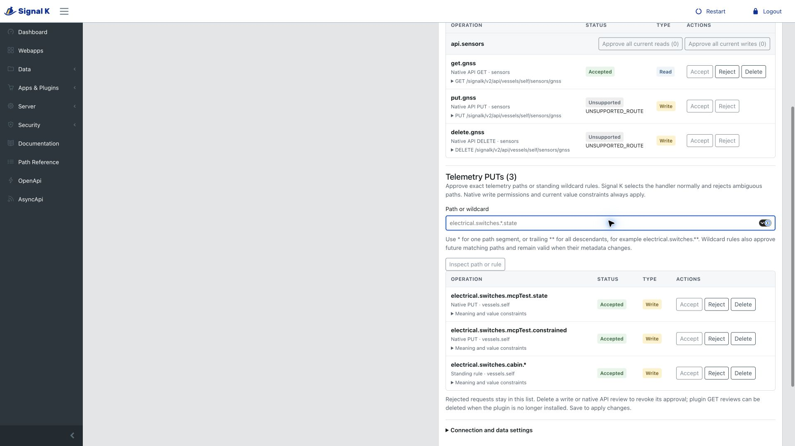

# Telemetry PUT approvals and standing rules

Telemetry PUTs use Signal K's normal handler selection. A command contains an exact `path` and `value`; no handler source is supplied. Signal K chooses the sole registered handler, rejects an ambiguous path with status 400, and reports unavailable handlers through its normal response. Discovery never invokes a handler.

## Discovery and meaning

`list_put_paths` accepts optional `prefix`, `offset` and `limit`. It lists `supportsPut: true` path candidates allowed by the caller's native path `put` ACL. It does not expose current values or prove that a handler exists. The gateway combines model paths, bounded metadata path hints observed through the public delta-input hook, and successfully described paths. A metadata-only target advertised before startup may require an explicit `describe_put` first. Discovery is incomplete and is not a stable snapshot.

`describe_put` accepts only `path`. It returns native metadata, value constraints, `schemaSource`, `schemaDiagnostics`, `approvalStatus`, `approvalSaved`, and `handlerSelection: native-default`. `enabled` means the schema, saved exact approval or matching standing rule, and caller permissions permit submission. It does not prove physical operation or an unambiguous handler.

`NO_INPUT_TYPE` means there is no declared type or explicit choice list; the path remains eligible for review and native handler validation. Unsupported types, keywords and malformed constraints block dispatch even when a standing rule matches. Current values, display scale and alarm zones never invent command types or limits. Description alone never queues a review.



## Explicit native value choices

When no explicit `metadata.schema` exists, native `possibleValues` entries with their own scalar `value` fields become an exact JSON Schema `enum`. This supports native `type: "multiple"` without pretending that `multiple` is a JSON type. An example is:

```json
{
  "supportsPut": true,
  "type": "multiple",
  "possibleValues": [
    { "title": "Off", "value": "off" },
    { "title": "Charger only", "value": "charger only" }
  ]
}
```

The reviewed input schema is `{"enum":["off","charger only"]}`. The native metadata is returned unchanged. Values are forwarded unchanged: strings, finite numbers, booleans and null are distinct; labels never become command values. There must be 1–128 unique bounded scalar choices. Missing values, objects/arrays, duplicate values and conflicts with declared enum/type/constraints block queueing and dispatch. Other native types remain unsupported; an explicit schema always retains precedence and cannot be rescued by display choices. Historical native `{id,name}` enum descriptors retain their existing behavior and are not converted into commands.

Existing supported type, range and other constraints are retained. Choices do not grant approval, bypass native permissions or validate handler registration. The complete native metadata and reviewed enum remain part of the exact approval binding; changed values or labels require fresh review. No type or command is inferred from telemetry, path names, units, display scales or alarm zones.

Both MCP discovery tools require a native write-capable identity and native path `put` authorization. The separate admin-only catalogue can inspect review metadata without granting the administrator execution permission. This does not grant access to current values; ordinary reads still need native read permission. Only `vessels.self` is supported. Metadata configuration paths are excluded.

## Review and execution

Call `put_value` with `{ "path": "electrical.switches.cabin.state", "value": false }`. Input validation, fresh native authentication, native path PUT permission and saved approval precede dispatch. There is no unit conversion, batch mutation or arbitrary HTTP route.

**Telemetry PUTs** is a separate table below the operation catalogue. Add a path manually, inspect its metadata/value contract, select **Accept and add**, then **Save Configuration**. Exact approvals retain their metadata/value binding; changed meaning or constraints need a new review. Eligible blocked calls can still queue a pending row without submitting the command. Both tables share one native Save and the existing 64 saved-review/request limit.

Administrators may instead enter a **standing wildcard rule**. `*` matches one complete dot-separated segment; a trailing `**` matches one or more descendant segments. A literal root is required: `electrical.switches.*.state` and `steering.autopilot.**` are valid; `**`, partial-segment globs and metadata paths are not. Rules apply to current and future matching paths, including future metadata changes. They do not require a currently discoverable match. Every invocation still has an exact path and is checked against current `supportsPut`, supported value constraints, caller identity and native PUT permission. Rules cannot authorize plugin HTTP operations, Resources writes or other vessel contexts.

A matching saved rejection wins over an approval, whether exact or wildcard. Removing one grant does not revoke access if another approved rule still matches. No MCP tool can create or save a rule. The admin-only catalogue endpoint previews review candidates; only the existing native configuration save persists decisions.

Existing source-specific approvals migrate automatically to path approvals, preserving metadata/value contracts and decisions. Entries with the same path and contract collapse, with rejection taking precedence. Migration is effective when configuration loads; the next native Save persists the source-free records. Reapproval is not required solely because the source field was removed. Existing clients must refresh their tool definitions and omit `source` in telemetry PUT calls; unknown input fields remain rejected.

Delete a PUT review, confirm the removal and save to revoke it. Native PUT rows do not depend on plugin inventory, so revocation is possible while a provider remains installed. Existing GET-row deletion rules continue to apply. Native saves still lack atomic conditional writes; the panel checks for conflicting edits but cannot eliminate simultaneous-save races in the host API.

`execute_mutation` supports only `{ "id": "signalk.put", "operation": "put_value", "arguments": { ... } }` and shares `put_value`'s implementation. `execute_capability` refuses this mutation. Mutation tool annotations explicitly declare writes, potentially destructive effects, external effects and no idempotence guarantee. Client annotations are hints; server-side checks enforce the boundary.

## Native permission boundary

Native `put` ACL permission is different from telemetry `write`. Both `readwrite` and `admin` identities require the applicable PUT grant; there is no admin ACL bypass.

Signal K 2.32.0 and 2.34.0 authorize HTTP PUT paths before default handler selection. The gateway uses the same null-source path `put` ACL check and forwards only the original bearer and `{ value }` through fixed-local HTTP. It does not impose an additional handler-specific authorization policy. Missing security hooks and unknown results fail closed. TLS verification and the native HTTP route checks remain active; redirects are refused. In-process PUT helpers are not used because they do not carry the authenticated request.

Checks occur immediately before submission and again when returning results or checking status. These are not an atomic transaction with another plugin's handler or with administrator configuration changes. A later permission change cannot cancel an action already accepted by the native server.

## Outcomes and request status

An accepted response contains `submitted: true`, `retrySafe: false`, an `outcome`, and a validated native request ID/reply when available. Native state and status codes are retained. `COMPLETED` with `statusCode: 502` is a completed failure, not success. No API response establishes physical operation.

`get_put_status` accepts only a native `requestId` known to this gateway. It reauthenticates the caller and rechecks ownership, exact target binding, current metadata, saved approval and native PUT permissions. Different tokens for the same native identity share that identity's access. Foreign, arbitrary, expired or lifecycle-cleared correlations remain unavailable, even though the native status endpoint itself does not enforce ownership.

Correlations are bounded to 128 entries and expire after one hour; plugin start/stop clears them. Capacity is reserved before submission. In-flight entries are never evicted to admit more writes. Unknown outcomes without a usable native ID also retain their reserved slot until expiry. Only owner/target/correlation metadata is retained, not command values or tokens.

Transport timeout, disconnect, invalid/oversized reply or authorization changes after submission can produce an explicit **unknown** outcome. Do not automatically submit the action again. Poll the validated original ID when available and still authorized; otherwise report that the result cannot be established. Disconnecting or aborting HTTP does not establish handler cancellation. Restart clears gateway correlation and cannot recover an unknown action by accepting arbitrary native IDs.

## Verification

Portable tests cover approval binding, schema/input validation, role/ACL checks, correlation bounds, expiry and truthful outcomes. Native integration uses disposable Signal K servers and synthetic PUT handlers, including metadata-only targets, actual native admin saves, native default handler selection, ambiguous-handler refusal, standing rules for subsequently registered paths, preserved legacy decisions, pending ownership, failure replies and lifecycle changes. No live hardware, vessel credentials or notification service is involved.

The supported matrix remains Signal K 2.32.0/2.34.0 on Node 22/24. Record actual runs and remaining limits in [verification](verification.md); implementation, local tests, CI, publication and deployment are separate evidence.
